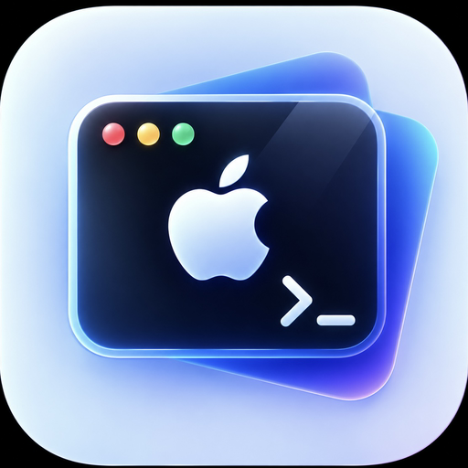

# Lab

**iOS 内核工具箱 · IPA 分析 · 设备诊断**

基于 [lara](https://github.com/rooootdev/lara) 二次开发

iOS 16.0 – 18.7.1 · iOS 26.0.x

---

Lab 把两类工具合进了同一个 App：

- **内核工具箱** —— 通过 DarkSword 漏洞利用获得内核读写与沙盒外文件访问
- **分析工具** —— IPA 差异比对、本地化资源提取、包结构分析、崩溃日志归类

分析工具全部基于公开 API，**不依赖漏洞利用是否成功**。两者互不影响。

---

## 目录

- [快速开始](#快速开始)
- [功能](#功能)
- [安装说明](#安装说明)
- [与上游的差异](#与上游-lara-的差异)
- [常见问题](#常见问题)
- [许可与致谢](#许可与致谢)

---

## 快速开始

不想自己编译？直接用发布版：

1. 下载最新 Release 里的 `Lab.ipa`
2. 用 **ESign / AltStore / SideLoaded** 等工具，以你自己的 Apple ID 签名安装
3. 打开 App → 「内核」标签页 → 点 **运行漏洞利用** → 再点 **初始化系统**

想用 GitHub Actions 自动构建，见 [从源码构建](#从源码构建)。

---

## 功能

### 🔧 内核工具箱

| 功能 | 说明 |
|---|---|
| **运行漏洞利用** | 执行 DarkSword，建立内核读写通道 |
| **获取内核缓存** | 抓取并解析内核缓存，得到符号偏移 |
| **初始化系统** | 完成后利用（VFS + 沙盒逃逸），开放全盘读写 |
| **重启桌面** | 软重启 SpringBoard |
| **触发 Panic** | 强制内核崩溃，设备立即重启 |

三种利用方式可在设置中切换：`VFS` / `SBX` / `Hybrid`（默认 Hybrid）。

### 📁 文件管理器

浏览沙盒之外的完整文件系统（`/System`、`/var`、`/private` 等），支持查看文件信息、读写、删除、递归搜索。

### 🧰 工具箱（分析模块）

五个模块都只使用公开接口，无需任何内核权限：

**IPA 差异分析**
对比两个 IPA 的文件增删改。两级比对：路径集合 → CRC32 → SHA-256 内容确认，输出可分享的文本报告。

**IPA 本地化管理**
提取 `.strings` / `.stringsdict`，支持 binary plist 与 UTF-8/UTF-16 两种格式，可导出 JSON / TXT 对照表。

**应用行为分析**
解析 Info.plist 全部键值、隐私用途声明、`embedded.mobileprovision` 里的授权信息、动态库清单与资源类型分布。

**运行监控**
导入 `.ips` / `.crash` 日志，识别异常类型与终止原因，按内存、断言、动态链接、权限等维度自动归类。

**系统能力检测**
设备与系统信息，以及内核读写通道的实时状态。

---

## 安装说明

### 关于签名的一个常见误解

Lab 的内核功能**不依赖安装时注入的私有 entitlements**。

它的机制是：App 以普通方式签名安装 → 运行时通过 DarkSword 获得内核读写 → 再用 `sbx_escape` 从沙盒内部完成逃逸。也就是说，**系统是运行时被"说服"的，不是靠签名预先授权的**。

因此：

| 安装方式 | 能否工作 |
|---|---|
| Apple ID 自签（ESign / AltStore） | ✅ 正常 |
| TrollStore | ✅ 正常 |
| Xcode 真机调试 | ⚠️ 调试器附加时功能会被禁用 |

> 本项目早期文档曾要求必须使用 TrollStore，那是错误的判断，已更正。

### 支持范围

| 系统版本 | 状态 |
|---|---|
| iOS 17.0 – 18.7.1 | ✅ 支持 |
| iOS 26.0 – 26.0.1 | ✅ 支持 |
| iOS 16.x | ⚠️ 理论受影响，偏移未完整验证 |
| iOS 18.7.2+ / 26.1+ | ❌ 不支持 |
| A19 / M5 及更新芯片 | ❌ 因 MIE 无法使用 |

M 系列 CPU 设备如遇问题，可在 **设置 → 修改偏移** 中将 `t1sz_boot` 设为 `0x11`。

### ⚠️ 风险提示

- 漏洞利用存在失败概率，失败通常无害，重试即可
- **触发 Panic 会让设备立即重启**，正在写入的数据可能丢失
- 内核内存写入若越界，最坏情况需要恢复模式重刷系统
- 请先备份重要数据

本工具仅供在**你自己的设备**上研究与学习使用。

---

## 与上游 lara 的差异

### 新增的功能

- 五个 IPA 分析与诊断模块
- 纯 Swift 实现的 ZIP 解析器（去除第三方依赖）
- 工具箱卡片式入口页
- 结构性 CI 自检体系
- 中文界面

### 修复的上游构建问题

| 问题 | 影响 |
|---|---|
| `CURRENT_PROJECT_VERSION = Release` | 非数字值，xcodebuild 直接报错 |
| 项目级 `IPHONEOS_DEPLOYMENT_TARGET = 26.0` | 未来版本号，构建失败 |
| 缺少共享 scheme | CI 里 `xcodebuild -scheme` 找不到目标 |
| 桥接头残留无实现的函数声明 | 编译能过但链接期失败 |

---

## 常见问题

**Q：点了「运行漏洞利用」没反应？**
A：检查是否有调试器附加（Xcode 运行时会出现此限制）。另外该功能本身有失败概率，重试是正常的。

**Q：文件管理器提示"未就绪"？**
A：需要先依次完成「运行漏洞利用」→「获取内核缓存」→「初始化系统」。

**Q：本地化管理显示"共 0 个本地化文件"？**
A：这是正常的。很多 App 把界面文字硬编码在代码里，不使用 `.strings` 文件。系统应用、社交类和游戏类应用的本地化文件通常较多。

**Q：能不能读取其他 App 的沙盒数据？**
A：完成「初始化系统」后可以。在此之前受沙盒限制。请注意这属于高权限操作，谨慎使用。

**Q：iOS 升级后还能用吗？**
A：不保证。漏洞利用与具体系统版本和内核布局强相关。

---

## 许可与致谢

本项目基于 **[lara](https://github.com/rooootdev/lara)** 二次开发，继承其 **AGPL-3.0** 授权。完整条款见 [`LICENSE`](LICENSE)。

如果你分发本项目的修改版或编译产物，请遵守 AGPL-3.0：保留原作者署名与许可证文本，并以相同授权开源你的修改。

### 原始项目

- **[rooootdev](https://github.com/rooootdev)** — lara 原作者
- **ruter** — lara 主程序与内核工具链
- **neon** — respring 脚本、zipmgr、锁屏主题修复、应用解密
- lara 社区与全部贡献者 · [Discord](https://discord.gg/gw8PcRF3Jr)

### 底层组件

| 组件 | 用途 |
|---|---|
| [ChOma](https://github.com/alfiecg24/ChOma) | Mach-O 与代码签名解析 |
| [libgrabkernel2](https://github.com/wh1te4ever/libgrabkernel2) | 内核缓存抓取 |
| [XPF](https://github.com/0xH1v3/XPF) | 内核补丁框架 |
| DarkSword | 内核漏洞利用 |

各组件的许可文本见 `Lab/licenses/`。

---

**免责声明**

本项目仅供在你自己的设备上进行安全研究与学习。
使用者需自行承担设备数据丢失或系统损坏的风险，
并确保行为符合当地法律法规。
本项目不提供任何形式的明示或暗示担保。

